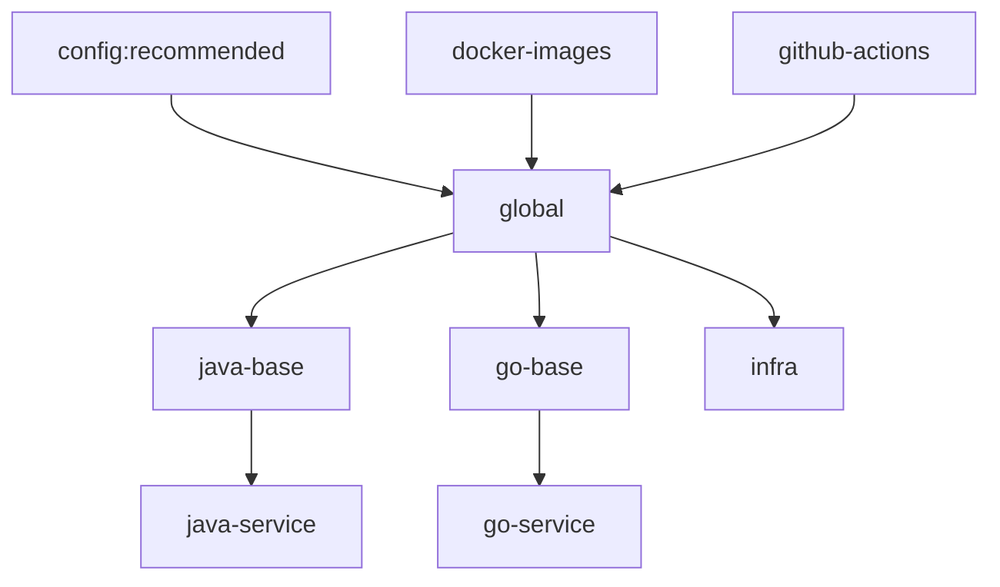

# demo-renovate-advanced-config

Presets Renovate partagés et workflow Renovate unique des dépôts `clevertechware/demo-renovate-advanced-*`. Dépôt de démo
de la série sur Renovate.

## Hiérarchie des presets



Une flèche va d'un preset vers celui qui l'étend ou l'inclut.

| Preset | Contenu |
|---|---|
| `default` | `enabled: false`. Renovate ne l'applique automatiquement qu'à un dépôt nommé `renovate-config`. |
| `global` | `config:recommended`, `docker-images`, `github-actions`, dashboard, `minimumReleaseAge` avec `internalChecksFilter: strict`, `gitIgnoredAuthors`, limites de PR. |
| `docker-images` | Majeures de `postgres` soumises à approbation ; `eclipse-temurin` limité aux versions LTS. |
| `github-actions` | Fusion automatique des mises à jour minor et patch. |
| `java-base` | Étend `global` ; majeure de `spring-boot-starter-parent` soumise à approbation. |
| `go-base` | Étend `global` ; `gomodTidy`, `gomodUpdateImportPaths` ; groupe `bun`. |
| `infra` | Étend `global`. |
| `java-service`, `go-service` | Étendent `java-base` et `go-base` ; point d'entrée des dépôts de service. |

## Brancher un dépôt

Ajouter `.github/renovate.json` au dépôt, sans workflow Renovate local :

```json
{
  "extends": ["github>clevertechware/demo-renovate-advanced-config//infra"]
}
```

Le nom du dépôt doit correspondre à `clevertechware/demo-renovate-advanced-*` (filtre de découverte) et la GitHub App Renovate
doit y être installée. Le `renovate.json` étant déjà commité, l'onboarding est désactivé.

## Workflows

- `validate.yml` : exécute `renovate-config-validator --strict` sur tous les presets, à chaque push et pull request.
- `renovate.yml` : passage nocturne (02:00 UTC) ou manuel sur tous les dépôts découverts. Requiert la variable
  `RENOVATE_APP_CLIENT_ID` et le secret `RENOVATE_APP_PRIVATE_KEY`. Il échoue tant que l'App n'est pas créée.

`RENOVATE_AUTODISCOVER_FILTER` est un motif glob. Plusieurs filtres se séparent par une virgule, donc le motif lui-même
n'en contient pas.

## Valider en local

```bash
npx --yes --package renovate@44 -- renovate-config-validator --strict *.json
```

Les fichiers passés en argument sont validés comme configuration globale. Une option réservée à l'auto-hébergement
(`autodiscover`, par exemple) n'y est pas rejetée, y compris dans un preset.
